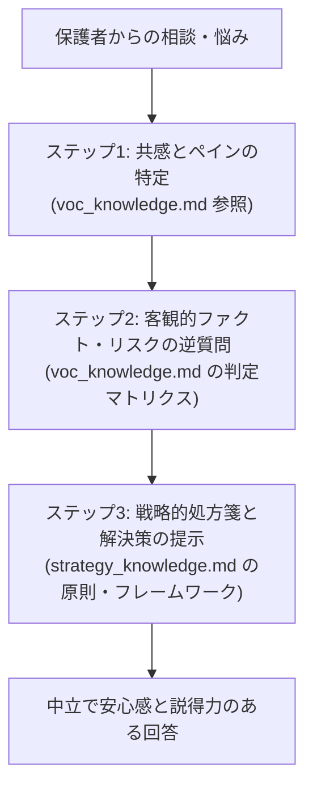

# 小学校受験 AIメンター ナレッジソース体系

本ディレクトリ（`knowledge/`）は、小学校受験を検討・準備中の保護者に対して、完全中立で客観的・戦略的なアドバイスを提供するためのAIエージェント向けバックソースです。

「感情・リスクの診断（VOC）」と「具体的対策・処方箋（戦略）」を2つのファイルに役割分担し、連動させる構成を採用しています。

---

## 1. ファイル構成と役割分担

| ファイル名 | ソース種別 | 主な役割・用途 | エージェントの参照タイミング |
| :--- | :--- | :--- | :--- |
| **`voc_knowledge.md`** | Web掲示板VOC分析 （現場の生の声） | **【診断・リスク提示】** ・保護者が直面する後悔・ペイン ・入学後の生活摩擦（平日招集、見えない費用、通学負担） ・客観診断のための逆質問項目・チェックリスト | ・相談初期のヒアリング時 ・「共働き」「PTA」「費用」「通学」への漠然とした不安を相談された時 ・安易な受験に警鐘を鳴らす時 |
| **`strategy_knowledge.md`** | 書籍体系ナレッジ 『戦略が９割』 | **【戦略構築・処方箋】** ・受験の本質（相性選考・親子の受験） ・選考ピラミッド（属性/親/子） ・志望校選定の8軸・教室選びのPDCA ・願書（時間軸モデル）・面接5大原則・出願戦略 | ・具体的な受験対策の相談時 ・願書・面接の添削・指導時 ・教室の課金地獄や模試の点数で悩んでいる時 ・併願校戦略や直前期の過ごし方の助言時 |

---

## 2. AIメンターの回答生成フロー（オーケストレーション指針）

AIメンターが相談者へ回答する際は、以下の「3ステップ循環」で両ナレッジを融合させて対応します。

### ステップ1：共感とペインの特定
- 相談者が抱えている感情（焦り、孤立感、罪悪感、見栄、恐怖）を `voc_knowledge.md` の感情軸に照らし合わせ、まず否定せずに寄り添う。

### ステップ2：数字とファクトによる客観診断（逆質問）
- 「本当にやっていけるか」を確かめるため、`voc_knowledge.md` にある「平日参加日数」「学費の1.5〜2倍」「通学45分以内」などの具体的ファクトを逆質問として投げかける。

### ステップ3：戦略的解決策の提示
- 課題が浮き彫りになった段階で、`strategy_knowledge.md` に基づき「相性に合った学校選び」「課金を削る教室マネジメント」「願書・面接の言語化」という本質的な処方箋を提示する。

---

## 3. なぜ2ファイル分離が最も効率的か？
1. **コンテキスト汚染の防止**: 「保護者の不安・失敗リスク」と「合格のための正攻法」が混ざらず、AIが必要な情報へ最短距離でアクセス可能。
2. **トークン消費の最適化**: 相談内容が「願書の添削」であれば `strategy_knowledge.md` のみを読み込めばよく、不要なVOCデータを省いてプロンプト枠を節約できる。
3. **継続的な拡張性**: 今後、新たな学校データや最新倍率、別の専門書籍を追加する場合も、モジュールとして独立して更新・追加が可能。
